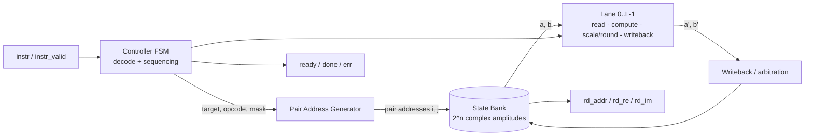

# Block Diagram and Microarchitecture (tracker task 0.5)

## Blocks
| Block | File (planned) | Role |
|---|---|---|
| Controller | rtl/controller.v | decode, FSM: IDLE -> ISSUE -> DRAIN -> COMMIT |
| Address generator | rtl/addr_gen.v | emits (i, j=i^(1<<q)) pairs, bit q of i = 0, `LANES` pairs per cycle |
| State bank | rtl/state_bank.v | register array of 2^n complex amplitudes, init to \|0..0\| |
| Lane | rtl/lane.v | pipeline: read -> compute (gate datapath) -> scale/round -> writeback |
| Arithmetic | rtl/fx_arith.v | sign-extend, round, saturate helpers |
| Gate datapaths | rtl/gate_*.v | H, T, X, Z, CNOT, MC phase flip |
| Top | rtl/qsim_top.v | wires everything together |

## Execution of one gate
For a one-qubit gate on target q there are 2^(n-1) independent pairs. With L lanes the controller issues L pairs per cycle, so a gate takes about 2^(n-1)/L issue cycles plus the pipeline drain.
Multi-controlled phase flip and Z touch single amplitudes; they are executed as 2^n elements, L per cycle.
